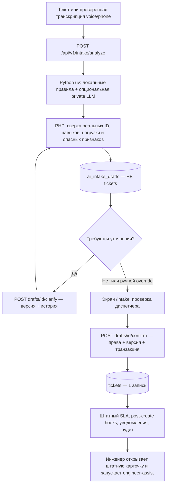

# 02_ДЕН — серверный AI-приёмщик и ручное подтверждение

**Актуализация:** 14.11.2026. **Основа:** `feature/engineer-ai` из `Dum-senior/digital-challenge-hackathon` (OpenHelpDesk). **Роль владельца:** Ден. Этот модуль не затрагивает `src/EngineerAssistant.php`, голосовой STT, телефонию, штатный SLA, пользователей или алгоритм autoAssignTicket().

## Обязательный путь



## Разделение ответственности

- `services/intake-ai/`: `uv`, FastAPI, локальный OpenAI-compatible LLM, извлечение полей по исходному тексту, классификация с аварийными правилами. Данные пользователей, групп, навыков, загрузки и реальные DB-ID Python НЕ получает и НЕ хранит.
- `src/IntakeDispatcher.php`: доверенный PHP-адаптер. Серверная валидация, дополнительные правила безопасности, `locations`, `ticket_types`, `ticket_priorities`, группа, навыки, текущие не закрытые заявки, доступность и out-of-office.
- `src/routes/intake.php`: штатный Bearer API `/api/v1/intake/...` и сессионный интерфейс `/intake/...`. Тот же пользователь OpenHelpDesk; браузер требует `X-CSRF-Token`; API требует текущего пользовательского Bearer. Секрет сервиса никогда не возвращается браузеру.
- `database/migrations/096_ai_intake_drafts.php`: одна минимальная таблица в существующей MariaDB. Отдельная БД не создаётся.
- `/intake`: интерфейс ввода/очереди/уточнения/подтверждения. Ссылку в меню основной системы команда может добавить после UI-review; страница доступна непосредственно по URL.

## Почему не `ticket_drafts`

Штатная `ticket_drafts` — автосохранение конкретной формы `(user_id,context,ticket_id)`, без запрета окончательного назначения, истории ответов, уникального request_id, версии подтверждения и связи с AI-снимком. Создание настоящего ticket до confirmation запускает SLA/уведомления/назначения, поэтому использовать его вместо AI-черновика нельзя.

## Ролевой контракт

- `POST /api/v1/intake/analyze`: существующий Bearer токен заявителя/сотрудника. JSON `{ "text": "...", "source": "text|voice|phone", "request_id": "optional-idempotency-key" }`; возвращает `201`, реальный `draft_id`, `revision=1`, `status`, `raw_text`, `extracted`, `recommendation`, `questions`, `missing_fields`. Никакого `ticket_id` до создания; повтор того же ключа/текста — `200` и тот же черновик; другой текст при прежнем ключе — `409`.
- `GET /api/v1/intake/drafts`: свои черновики или очередь уполномоченного диспетчера (метаданные без текста); `GET /api/v1/intake/drafts/{id}`: приватные данные владельцу или диспетчеру, остальным `404`.
- `POST /api/v1/intake/drafts/{id}/clarify`: `{ "revision": 1, "answer": "...", "edits": {..} }`. Владелец может отвечать, поля редактирует только диспетчер. Ответы добавляются в версионированную историю, модель получает новую строку, `revision` увеличивается. Конкурирующее изменение — `409`. При ручной коррекции сервер повторно валидирует допустимые ID.
- `POST /api/v1/intake/drafts/{id}/confirm`: только staff-role, чья роль входит в `INTAKE_CONFIRM_ROLES` (или admin). Нужны `revision`, `approve:true`, необязательный `approved` с исправленными полями. При статусе `failed`/`needs_clarification` нужен `manual_review_reason` от 20 символов, который сохраняется в журнале. При потенциальной аварии нужен явно выбранный приоритет; снижение относительно безопасной рекомендации требует отдельного обоснования. Проверяются ID, принадлежность инженера группе, допустимость типа/приоритета. Создание ticket + обновление черновика + аудит выполняются в одной транзакции; повтор возвращает тот же ticket ID (`200`, а не второй INSERT). Сервис не вызывает `engineer-assist` автоматически.
- `/intake/...`: те же маршруты с сессионной авторизацией/CSRF. `GET /intake/meta` возвращает допустимые справочники; внутренние группы/инженеры выдаются только диспетчеру.

**Важно:** `INTAKE_CONFIRM_ROLES=admin,dispatcher` — это список реальных role.slug, а не фиктивный пользователь. В базовой OpenHelpDesk имеется роль `admin`, но роль `dispatcher` должна существовать как штатная staff-role, иначе подтверждать может только администратор. Не выдавать portal/user возможность подтверждения.

## Схема данных

`ai_intake_drafts`: owner `user_id`; строка `raw_text` и `source`; SHA-256 `request_key` + `request_fingerprint`; `analysis_json`, `original_analysis_json` (неизменный AI-снимок), `edited_json`, `conversation_json`; `status`; `revision`; `confirmed_ticket_id`; `confirmed_by`; `postprocess_state`; индексы для владельца и очереди. В архиве и журнале остаются реальные изменения, а не «средняя оценка уверенности».

Поля предложения: `subject`, `description`, `raw_text`, `category`, `type_id`, `tags`, `location_name/location_id`, `object`, `floor/room`, `equipment`, `serial_number`, `ip_addresses`, `error_codes`, `symptoms`, `incident_time`, `affected_scope`, `priority/priority_id`, `severity_reason`, `is_potential_emergency`, `recommended_group_id/recommended_assignee_id`, `assignment_reason`, `missing_fields`, `questions`, `requires_human_review`.

**`null` означает «не подтверждено», а не «любой ID допустим».** Примеры из демоданных никогда не переносятся в production ID. Если в живом справочнике не находится ровно одно текстовое соответствие (или имя типа/приоритета отличается), ID остаётся `null`, диспетчер выбирает существующую запись вручную.

## Демо-правила: НЕ норматив заказчика

| Ситуация | Правило | Ожидаемое действие |
|---|---|---|
| Один принтер не печатает | низкий/обычный приоритет по каталогу | уточнить кабинет и оборудование |
| Дым, искры, пожар, вымогатель | `is_potential_emergency=true`, `critical` | показать предупреждение, не советовать перезапуск, ручная эскалация |
| Не поступает телеметрия одного узла | `telemetry`, серьёзность по правилу | запросить номер счётчика/масштаб; не объявлять аварию автоматически |
| Нет OPC и телеметрии нескольких скважин | массовый отказ → не ниже `high` | рекомендовать профильную группу и уточнить затронутые узлы |
| «Ничего не работает» | `needs_clarification` | вопросы по системе, месту и масштабу; не выдумывать IP |
| Массовая блокировка / выкуп за файлы | ИБ-флаги при наличии признаков | ручная оценка приоритета, запрет опасных команд |

Ожидаемое время SLA и динамические эскалации **не прогнозируются отдельным таймером** в этом модуле. После подтверждения вызывается действующий `Sla::initializeForTicket`; дальнейший путь — стандартные `Sla`, status и cron. До confirm нет SLA-состояния реальной заявки.

## Подбор инженера

`groups.name/description` и навыки действующих членов группы сопоставляются с категорией, исключаются конфиденциальные группы. Выбирается единственная группа с максимальной подтверждённой оценкой соответствия; при ничьей или отсутствии фактов ID null. В группе берутся члены из `group_user_map`, разрешённые штатные роли `staffRoleSqlIn('u.role')`, навыки из `user_skill_map` + `agent_skills`, `users.is_available`, `agent_oof_status.is_oof`. Открытые заявки подсчитываются по `tickets.assigned_to` и штатным `ticketClosedBucketSlugs()`. Выбирается сотрудник с подтверждённым навыком и минимальной нагрузкой, затем минимальным ID. Нет навыка/доступности — только группа. Назначение не производится до confirm. Штатные post-create automations после confirm могут скорректировать поле, поэтому рекомендуемое/фактическое назначение сверять в карточке.

## Вводные данные и ограничения безопасности

- Synthetic-only: 20 примеров из `services/intake-ai/data/demo_cases.jsonl`, фиктивный каталог в `data/demo_catalog.json` — **только для юнит-тестов**; в PHP выбираются живые ID.
- Не использовать реальные АТС, производственные IP/пароли, документы и личные звонки. `source=phone` — *уже проверенная* транскрипция, её безопасное получение обеспечивает модуль телефонии.
- Модель Qwen через локальный vLLM/llama.cpp внутри private-сети, OpenAI-compatible. Это самостоятельно размещённая модель с открытыми весами, а не гарантия коммерческой проприетарной модели. Секреты только через серверное окружение. У PHP и LLM — разные токены.
- HTTP API ограничен штатным rate limit, дополнительно не более 25 мутирующих операций intake в минуту на пользователя для API и сессии вместе. Ограничение при отказе БД закрывается (503).
- Выход LLM — недоверенный: поля без подтверждения исходным текстом отклоняются. Модель не выбирает и не присваивает реальные DB-ID. Нет автоисполнения команд оборудования.
- Отказ модели оставляет черновик `failed`, сохраняет ручной путь. Пока модель не запущена, полного AI-анализа нет; не выдавать правила за работу LLM.
- Исходное предложение и финальные поля сохранены в одном черновике; проверенные технические поля также добавляются в описание созданной заявки без самостоятельного создания новых справочников; `audit_log` фиксирует инициатора и список изменённых полей, `ticket_timeline` — связь с draft. Внешний журнал не содержит полные тексты потенциально чувствительных заявок.
- `postprocess_state=failed` означает, что ticket **создан**, но после транзакции не завершились hooks/уведомления. Прежде чем повторно отправлять уведомления, требуется ручная проверка; повтор `confirm` не инициирует их повторно.
- При планировании реальной эксплуатации нужны нагрузочные тесты, правила PII retention, дополнительные фильтры prompt injection, модельная оценка качества и аудит разрешений.

## Как применить (без GitHub/Codex)

В имеющемся **клоне** ветки `feature/engineer-ai` (или новой интеграционной ветки от неё) запустить скрипт `python apply_to_openhelpdesk.py /path/to/checkout`. Он проверит наличие `src/EngineerAssistant.php`, добавит только необходимые новые файлы и точечные дополнения `src/routes.php`, `database/schema.sql`, `.env.example`, `openapi.json`. Сохраняет другие API и middleware. Скрипт не выполняет ни `git push`, ни `database/seed.php`, ни миграцию сам.

В отдельном Python окружении:

```sh
cd services/intake-ai
uv sync --group dev
# задать INTAKE_SERVICE_TOKEN и ENABLE_LLM=true с self-hosted LLM, либо false для проверки правил
uv run pytest -q
uv run python -m intake_ai
```

У OpenHelpDesk добавить `INTAKE_AI_URL` (если Python запускается в Docker контейнере, разрешённый адрес сервиса), `INTAKE_AI_ALLOWED_HOSTS`, **тот же** `INTAKE_SERVICE_TOKEN` и `INTAKE_CONFIRM_ROLES`. Устанавливать Python-зависимости через `uv`, не через `pip`. БД тестировать только с отдельной `engineer_test`/`compose.test.yaml`, `MAIL_ENABLED=false`.

Для ручного испытания: авторизоваться в OpenHelpDesk, открыть `/intake`, ввести новый русский текст, проверить сохранённый ID черновика и отсутствие новых tickets, ответить на уточнение, войти диспетчером, подтвердить, затем открыть штатную карточку тикета и вручную нажать «Найти решение» (появится только после действительного ticket ID).

## Результаты

См. `TEST_RESULTS_02_DEN.md` в архиве. PHP lint и Python-тесты — отдельно от настоящих HTTP/PDO/MariaDB проверок. **Нельзя считать E2E и безопасность в production подтверждёнными, пока их не запустили на реальной ветке с MariaDB, браузером и серверной моделью.**
